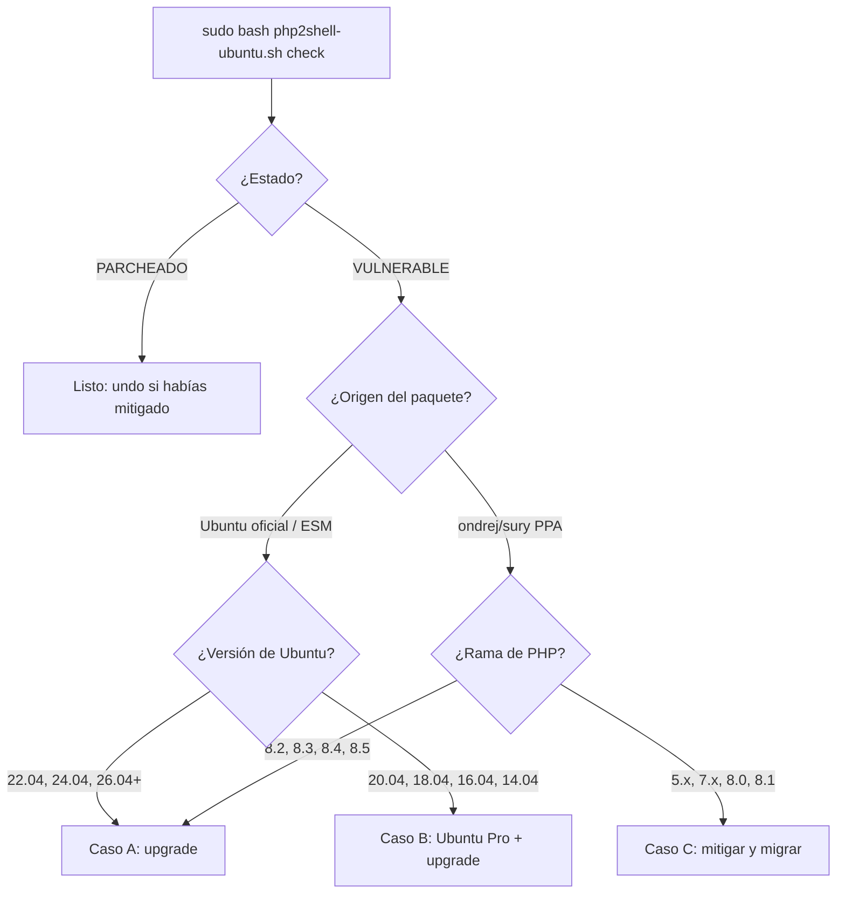

# php2shell-ubuntu

Script de diagnóstico, actualización y mitigación temporal para **PHP2Shell** (CVE-2026-109618 y CVE-2026-109619) en servidores **Ubuntu**.

PHP2Shell son dos vulnerabilidades críticas (CVSS v4.0 9.2) en el núcleo de PHP que permiten **ejecución remota de código sin autenticación**. Afectan a todas las versiones desde PHP 5.4 hasta 8.5.11 y a cualquier instalación que atienda peticiones web: PHP-FPM, Apache con mod_php, php-cgi, etc. Hay reportes de explotación activa.

> [!IMPORTANT]
> **La única solución completa es instalar un PHP corregido.** La vulnerabilidad está en el runtime de PHP, no en el código de tu aplicación: no se arregla editando el código. Las mitigaciones de este script reducen la superficie de ataque mientras actualizas, pero **no la eliminan**.

> [!WARNING]
> Este script se ejecuta como root y modifica la configuración de PHP y Apache, además de reiniciar servicios. **Léelo antes de ejecutarlo** y pruébalo primero en un servidor no crítico. Se entrega sin garantía (ver [Licencia](#licencia)).

---

## Índice

- [Qué hace](#qué-hace)
- [Requisitos](#requisitos)
- [Instalación](#instalación)
- [Uso rápido](#uso-rápido)
- [¿Qué camino me toca?](#qué-camino-me-toca)
  - [Caso A: puedo actualizar (upgrade)](#caso-a-puedo-actualizar-upgrade)
  - [Caso B: necesito Ubuntu Pro (Ubuntu 20.04 o anterior)](#caso-b-necesito-ubuntu-pro-ubuntu-2004-o-anterior)
  - [Caso C: no hay parche disponible](#caso-c-no-hay-parche-disponible)
- [Referencia de comandos](#referencia-de-comandos)
- [Qué archivos modifica](#qué-archivos-modifica)
- [Cómo verificar que quedaste parcheado](#cómo-verificar-que-quedaste-parcheado)
- [Problemas frecuentes](#problemas-frecuentes)
- [Limitaciones](#limitaciones)
- [Referencias](#referencias)
- [English summary](#english-summary)
- [Licencia](#licencia)

---

## Qué hace

| Modo | Qué hace | ¿Cambia el sistema? |
|---|---|---|
| `check` | Detecta cada versión de PHP instalada, de dónde viene (Ubuntu, ESM o PPA de Ondřej), si está parcheada, si hay actualizaciones pendientes, el estado de las mitigaciones y si quedan procesos con el binario antiguo en memoria. En Ubuntu ≤ 20.04 revisa además si Ubuntu Pro está adjunto. | No |
| `upgrade` | Ejecuta `apt-get update`, actualiza **solo** los paquetes PHP instalados (conservando tus archivos de configuración), reinicia PHP-FPM y Apache (si usa mod_php) y vuelve a correr `check`. | Sí |
| `mitigate` | Desactiva `session.upload_progress` (la ruta de explotación confirmada) en php.ini, en los pools de FPM y en Apache con mod_php. Luego reinicia los servicios. | Sí |
| `mitigate --memory` | Lo mismo, y además fija `memory_limit=-1` a nivel administrativo (mitigación de CVE-2026-109618). | Sí |
| `undo` | Quita todas las mitigaciones aplicadas por el script y reinicia los servicios. Úsalo **después** de parchear. | Sí |

**Cómo detecta si estás parcheado:**

- **Paquetes de Ubuntu (incluido ESM):** Ubuntu aplica el parche sobre la versión que ya distribuye, sin subir el número upstream. Por ejemplo, Ubuntu 24.04 trae `8.3.6-0ubuntu0.24.04.13`, que está parcheado aunque diga 8.3.6. Por eso el script busca los CVE en el changelog del paquete (`/usr/share/doc/phpX.Y-*/changelog.Debian.gz`).
- **PPA de Ondřej / packages.sury.org:** compara la versión upstream con las versiones corregidas: **8.2.35, 8.3.36, 8.4.27 y 8.5.12**.

---

## Requisitos

- Ubuntu con PHP instalado **desde paquetes** (`apt`): paquetes oficiales de Ubuntu, Ubuntu ESM o `ppa:ondrej/php`.
- Acceso root (`sudo`).
- Bash 4+ (viene por defecto en todas las versiones de Ubuntu soportadas).

**No cubre:** PHP compilado a mano, contenedores Docker, paneles con su propio PHP (cPanel/EasyApache, Plesk, DirectAdmin, CloudLinux alt-php, LiteSpeed lsphp), ni otras distribuciones (Debian, RHEL, CentOS, etc.). En esos casos sigue las instrucciones de tu proveedor.

---

## Instalación

```bash
# Descarga (ajusta la URL a este repositorio)
curl -fsSLO https://raw.githubusercontent.com/benjagdg/php2shell-ubuntu-fix/main/php2shell-ubuntu.sh

# Revísalo antes de ejecutarlo como root
less php2shell-ubuntu.sh
```

No necesita permisos de ejecución si lo llamas con `bash`. Si prefieres `./php2shell-ubuntu.sh`, haz `chmod +x php2shell-ubuntu.sh`.

---

## Uso rápido

El orden recomendado para **cada servidor**:

```bash
# 1. Diagnóstico (no cambia nada)
sudo bash php2shell-ubuntu.sh check

# 2. Mitigación inmediata mientras actualizas
sudo bash php2shell-ubuntu.sh mitigate

# 3. Actualizar PHP (si hay parche disponible; ver la sección siguiente)
sudo bash php2shell-ubuntu.sh upgrade

# 4. Cuando check diga PARCHEADO en todas las versiones, retirar las mitigaciones
sudo bash php2shell-ubuntu.sh undo
```

> [!TIP]
> Mitigar **antes** de actualizar cubre la ventana mientras esperas paquetes, mirrors atrasados o una suscripción de Ubuntu Pro.

---

## ¿Qué camino me toca?

Ejecuta `check` y mira dos datos de cada versión de PHP: el **origen** entre corchetes y la **versión de Ubuntu** en la cabecera.



### Caso A: puedo actualizar (upgrade)

**Aplica a:**

- Paquetes **oficiales de Ubuntu** en releases con soporte estándar: **22.04 LTS** (PHP 8.1), **24.04 LTS** (PHP 8.3), **26.04 LTS** y **26.10**. Ubuntu publicó el parche en [USN-8948-1](https://ubuntu.com/security/notices/USN-8948-1).
- **PPA de Ondřej** (`ppa:ondrej/php` o `packages.sury.org`) con PHP **8.2, 8.3, 8.4 u 8.5**. Las versiones corregidas son 8.2.35, 8.3.36, 8.4.27 y 8.5.12.

**Pasos:**

```bash
sudo bash php2shell-ubuntu.sh mitigate     # opcional pero recomendado
sudo bash php2shell-ubuntu.sh upgrade
```

`upgrade` hace lo siguiente:

1. `apt-get update`.
2. Actualiza solo los paquetes `php*` y `libapache2-mod-php*` ya instalados (`--only-upgrade`). No instala versiones nuevas de PHP ni toca el resto del sistema.
3. Conserva tus `php.ini` y pools (`--force-confold`).
4. **Reinicia** (no solo recarga) cada `phpX.Y-fpm` activo y Apache si usa mod_php. Reiniciar es obligatorio: los procesos viejos siguen ejecutando el código vulnerable aunque el paquete esté actualizado.
5. Vuelve a correr `check`.

Si al final dice `PARCHEADO` en todas las versiones y la sección "Procesos con binario PHP antiguo" dice `Ninguno`, retira las mitigaciones:

```bash
sudo bash php2shell-ubuntu.sh undo
```

**Si `upgrade` no encuentra nada nuevo**, revisa la sección [Problemas frecuentes](#problemas-frecuentes). La causa más común es un mirror del PPA atrasado.

### Caso B: necesito Ubuntu Pro (Ubuntu 20.04 o anterior)

**Aplica a:** paquetes oficiales de Ubuntu en releases fuera de soporte estándar: **20.04** (PHP 7.4), **18.04** (PHP 7.2), 16.04 y 14.04. Para estos, Canonical entrega el parche **solo** a través de **ESM (Expanded Security Maintenance)**, incluido en Ubuntu Pro ([USN-8948-2](https://ubuntu.com/security/notices/USN-8948-2)). Sin Pro adjunto, `apt` no ve los paquetes corregidos y `upgrade` no actualizará nada.

**Cómo saber si ya tienes Ubuntu Pro adjunto:**

```bash
sudo bash php2shell-ubuntu.sh check
```

La sección "Ubuntu Pro / ESM" te dirá una de estas tres cosas:

- `Ubuntu Pro NO está adjunto`: sigue los pasos de abajo.
- `esm-infra NO habilitado`: ejecuta `sudo pro enable esm-infra`.
- `esm-infra habilitado`: salta directo al paso 4.

> [!NOTE]
> Si ejecutas `pro status` a mano, ojo: cuando la máquina **no** está adjunta, la tabla muestra `esm-infra yes`, pero ese `yes` significa *disponible*, no *habilitado*. Una máquina adjunta muestra una columna adicional con `enabled`.

**Pasos:**

1. **Consigue un token.** Entra a [ubuntu.com/pro](https://ubuntu.com/pro) con una cuenta Ubuntu One. Canonical ofrece una suscripción gratuita para hasta 5 máquinas, pensada para uso personal y comercial a pequeña escala; revisa los términos vigentes al registrarte. Para más máquinas o uso empresarial existe la suscripción pagada. El token aparece en tu dashboard de Ubuntu Pro.

2. **Actualiza el cliente y adjunta la máquina:**

   ```bash
   sudo apt update
   sudo apt install --only-upgrade ubuntu-advantage-tools
   sudo pro attach <TU_TOKEN>
   sudo pro status          # esm-infra y esm-apps deben decir "enabled"
   ```

3. **Pregúntale a Ubuntu si el parche ya existe para tu sistema:**

   ```bash
   sudo pro fix CVE-2026-109618
   sudo pro fix CVE-2026-109619
   ```

   `pro fix` instala el paquete corregido si está disponible, o te dice que todavía no existe.

4. **Actualiza con el script** (instala el resto de paquetes PHP desde ESM y reinicia los servicios):

   ```bash
   sudo bash php2shell-ubuntu.sh upgrade
   ```

5. Si `check` dice `PARCHEADO`, retira las mitigaciones con `undo`.

> [!WARNING]
> Al momento de escribir esto, el [tracker de CVEs de Ubuntu](https://ubuntu.com/security/cves?q=CVE-2026-109618) marcaba `php7.2` (18.04) y `php7.4` (20.04) como "Needs evaluation", aunque USN-8948-2 anuncia cobertura para esas releases. **Incluso con Ubuntu Pro, el paquete corregido podría no estar publicado aún.** Si `pro fix` dice que no hay parche, trata el servidor como [Caso C](#caso-c-no-hay-parche-disponible) mientras tanto.

**¿No puedes o no quieres usar Ubuntu Pro?** Tu servidor queda en el [Caso C](#caso-c-no-hay-parche-disponible).

### Caso C: no hay parche disponible

**Aplica a:**

- PHP **5.x, 7.x, 8.0 u 8.1** instalado desde el **PPA de Ondřej**. php.net solo publicó releases corregidas para 8.2–8.5; para 7.4, 8.0 y 8.1 publicó parches de código fuente, no paquetes.
- Ubuntu ≤ 20.04 **sin** Ubuntu Pro, o con Pro pero sin paquete publicado todavía.

**Qué hacer:**

1. **Aplica la mitigación completa:**

   ```bash
   sudo bash php2shell-ubuntu.sh mitigate --memory
   ```

   - `session.upload_progress.enabled=0` cierra la ruta de explotación confirmada.
   - `memory_limit=-1` es la mitigación principal que recomienda PHP para CVE-2026-109618. Se aplica con `php_admin_value`, así que la aplicación no puede volver a ponerle un límite con `ini_set()` ni `.htaccess`.

   > [!CAUTION]
   > Con `memory_limit=-1`, **una sola petición puede consumir toda la RAM** del servidor. Monitorea la memoria (`free -m`, `htop`) y considera ponerle un techo al servicio con systemd/cgroups. Ejemplo para FPM:
   >
   > ```bash
   > sudo systemctl edit php7.4-fpm
   > # agregar:
   > # [Service]
   > # MemoryMax=2G
   > sudo systemctl restart php7.4-fpm
   > ```
   >
   > No uses `ulimit -v` / `RLIMIT_AS` para esto: puede disparar justamente la ruta vulnerable.

2. **Baja `post_max_size`** en el `php.ini` de cada SAPI (el script no lo hace automáticamente para no romper formularios): **8M** si la aplicación no recibe archivos, **32M** si los recibe, con `upload_max_filesize` por debajo de ese valor.

3. **Bloquea peticiones multipart en Apache** si la aplicación no recibe archivos, o permítelas solo en las rutas que los necesitan. Por ejemplo, en `/etc/apache2/conf-available/php2shell-multipart.conf`:

   ```apache
   <If "%{HTTP:Content-Type} =~ m#^multipart/#i && %{REQUEST_URI} !~ m#^/(ruta/upload|otra/ruta)#">
       Require all denied
   </If>
   LimitRequestBody 33554432
   ```

   ```bash
   sudo a2enconf php2shell-multipart && sudo apache2ctl configtest && sudo systemctl reload apache2
   ```

   En Nginx o en tu WAF/CDN, aplica una regla equivalente.

4. **Reduce la exposición:** si el servidor no necesita estar abierto a todo internet, restríngelo por IP, ponlo detrás de una VPN o desactiva temporalmente herramientas expuestas como phpMyAdmin.

5. **Planifica la migración** a una versión con soporte: Ubuntu 24.04 con PHP 8.3, o PHP 8.3/8.4 desde el PPA de Ondřej, o un contenedor oficial `php:8.3`. El salto desde 7.x requiere revisar el código: funciones eliminadas, comparaciones más estrictas, `each()`, `create_function()`, etc.

6. **Busca señales de compromiso:** procesos de PHP o Apache que lancen `sh`, `bash`, `curl` o `wget`; archivos `.php` nuevos en directorios de uploads; tráfico saliente inusual.

   ```bash
   ps -ef --forest | grep -B1 -A3 -E 'php-fpm|apache2' | grep -E 'sh|curl|wget'
   find /var/www -name '*.php' -newermt '2026-10-20' -ls
   ```

---

## Referencia de comandos

```text
sudo bash php2shell-ubuntu.sh check
sudo bash php2shell-ubuntu.sh upgrade
sudo bash php2shell-ubuntu.sh mitigate
sudo bash php2shell-ubuntu.sh mitigate --memory
sudo bash php2shell-ubuntu.sh undo
```

Sin argumentos, el script ejecuta `check`. Todos los modos son idempotentes: puedes ejecutarlos varias veces sin duplicar configuración. Por ejemplo, correr `mitigate` y después `mitigate --memory` deja una sola mitigación, ahora con `memory_limit=-1`.

### Ejemplo de salida de `check`

```text
== Sistema: web01 — Ubuntu 18.04 (Ubuntu 18.04.6 LTS) ==

== PHP 7.2 ==
  Paquete instalado : 7.2.24-0ubuntu0.18.04.17  [Ubuntu oficial]
  Estado            : VULNERABLE
  -> Fix solo vía Ubuntu Pro/ESM (USN-8948-2). Revisa: pro status / pro fix CVE-2026-109618
  [apache2] session.upload_progress.enabled='0'  memory_limit='128M'  post_max_size='64M'

== Procesos con binario PHP antiguo en memoria (requieren reinicio) ==
  Ninguno

== Apache: directivas PHP en la config (mod_php) ==
  Mitigación Apache activa (/etc/apache2/conf-enabled/php2shell-mitigation.conf)
  /etc/apache2/conf-enabled/php2shell-mitigation.conf:4:    php_admin_flag session.upload_progress.enabled off

== Ubuntu Pro / ESM (necesario para parchear en 18.04) ==
  Ubuntu Pro NO está adjunto: ESM no entrega parches. Ejecuta: pro attach <token>
```

---

## Qué archivos modifica

| Archivo | Modo | Contenido |
|---|---|---|
| `/etc/php/X.Y/{fpm,apache2,cgi}/conf.d/99-php2shell-mitigation.ini` | `mitigate` | `session.upload_progress.enabled = 0` |
| `/etc/php/X.Y/fpm/pool.d/*.conf` | `mitigate` | Bloque delimitado por `; >>> php2shell mitigation` y `; <<< php2shell mitigation` con `php_admin_flag` / `php_admin_value` |
| `/etc/php/X.Y/fpm/pool.d/*.conf.bak-php2shell` | `mitigate` | Respaldo de cada pool antes del primer cambio (no se borra con `undo`) |
| `/etc/apache2/conf-available/php2shell-mitigation.conf` (+ enlace en `conf-enabled`) | `mitigate` (solo con mod_php) | `php_admin_flag` / `php_admin_value` para mod_php 7 y 8 |
| Paquetes `php*`, `libapache2-mod-php*` | `upgrade` | Actualización vía `apt` |

`undo` elimina los drop-ins, los bloques marcados en los pools y la conf de Apache. Los respaldos `.bak-php2shell` quedan por seguridad; puedes borrarlos a mano cuando ya no los necesites.

Antes de reiniciar, el script valida la configuración con `php-fpmX.Y -t` y `apache2ctl configtest`. Si la validación de Apache falla, revierte su propio cambio y se detiene.

---

## Cómo verificar que quedaste parcheado

1. `sudo bash php2shell-ubuntu.sh check` debe mostrar `PARCHEADO` en todas las versiones y `Ninguno` en "Procesos con binario PHP antiguo".

2. En paquetes de Ubuntu, el changelog debe mencionar los CVE:

   ```bash
   zgrep -E 'CVE-2026-10961[89]' /usr/share/doc/php8.3-common/changelog.Debian.gz
   ```

3. Comprueba lo que realmente ejecuta tu servidor web, no solo la CLI. Crea un archivo temporal, ábrelo en el navegador y **bórralo enseguida**:

   ```php
   <?php echo PHP_VERSION, ' | upload_progress=', ini_get('session.upload_progress.enabled'), ' | memory_limit=', ini_get('memory_limit');
   ```

> [!NOTE]
> Los paquetes de Ubuntu mantienen el número de versión upstream (por ejemplo, 8.3.6). Algunos escáneres de vulnerabilidades los marcarán como vulnerables aunque estén parcheados. Guíate por el changelog o por `pro fix`, no por el número de versión.

---

## Problemas frecuentes

**`upgrade` dice "ya está en su versión más reciente" y `check` sigue diciendo VULNERABLE**

- **Ubuntu ≤ 20.04:** casi seguro no tienes Ubuntu Pro adjunto. Ve al [Caso B](#caso-b-necesito-ubuntu-pro-ubuntu-2004-o-anterior).
- **PPA de Ondřej:** algunos mirrors del PPA van atrasados. Verifica con:

  ```bash
  apt-cache policy php8.3-fpm
  ```

  Si la versión candidata no es la corregida, apunta tu `sources.list` a `ppa.launchpadcontent.net` en lugar del mirror, o espera unas horas. En arm64 los builds del PPA tardaron más que en amd64.
- **Rama sin fix (7.x/8.0/8.1 del PPA):** no habrá paquete. Ve al [Caso C](#caso-c-no-hay-parche-disponible).

**`check` muestra `memory_limit='128M'` aunque apliqué `mitigate --memory` con Apache mod_php**

Es esperable. El valor que imprime `check` por SAPI se lee de `php.ini`, y la mitigación para mod_php vive en la configuración de Apache (`php_admin_value`), que solo se aplica dentro de Apache. Confírmalo con el archivo temporal de la sección [Cómo verificar](#cómo-verificar-que-quedaste-parcheado), o revisa la sección "Apache" del `check`, que debe decir `Mitigación Apache activa`.

**Aparece "Ojo: hay memory_limit definido en sites-enabled"**

Algún VirtualHost define su propio `memory_limit`, que puede pisar el valor global de la mitigación. Revisa ese vhost y ajústalo a mano.

**`pro status` muestra `esm-infra yes` pero `check` dice que Pro no está adjunto**

Ver la nota del [Caso B](#caso-b-necesito-ubuntu-pro-ubuntu-2004-o-anterior): ese `yes` significa *disponible*, no *habilitado*.

**`check` muestra `(sin phpX.Y-cli)`**

Esa versión no tiene CLI instalado, así que el script no puede leer los valores efectivos de `php.ini`. El resto del diagnóstico sigue siendo válido.

**Tras `upgrade` aparecen PIDs en "Procesos con binario PHP antiguo"**

Algún proceso sigue usando el PHP viejo, por ejemplo workers de colas, supervisord o un php-fpm con un nombre de servicio no estándar. Identifícalo con `ps -fp <PID>` y reinícialo.

---

## Limitaciones

- Solo cubre PHP instalado vía `apt` en las rutas estándar `/etc/php/X.Y/`.
- La mitigación de Apache cubre mod_php 7 y 8 (`mod_php7.c` y `mod_php.c`). PHP 5 en Ubuntu (14.04) usa otras rutas y no está soportado.
- No configura Nginx, LiteSpeed, FrankenPHP, ni WAF/CDN.
- No baja `post_max_size` ni bloquea multipart automáticamente, porque depende de cada aplicación.
- Las mitigaciones reducen el riesgo en las rutas conocidas; **no sustituyen al parche**.
- No detecta compromisos previos. Si el servidor estuvo expuesto y sin mitigar, revisa logs y procesos.

---

## Referencias

- Anuncio y advisory de PHP: [php.net](https://www.php.net/archive/2026.php#2026-10-21-5) · [GHSA-w8hw-w9fx-j79w](https://github.com/php/php-src/security/advisories/GHSA-w8hw-w9fx-j79w) (CVE-2026-109618) · [GHSA-6wmf-4rv5-p3rp](https://github.com/php/php-src/security/advisories/GHSA-6wmf-4rv5-p3rp) (CVE-2026-109619)
- Ubuntu: [USN-8948-1](https://ubuntu.com/security/notices/USN-8948-1) · [USN-8948-2](https://ubuntu.com/security/notices/USN-8948-2) · [Blog de Ubuntu sobre php2shell](https://ubuntu.com/blog/php2shell-vulnerability-fixes-available) · [Tracker CVE-2026-109618](https://ubuntu.com/security/cves?q=CVE-2026-109618)
- [CERT-EU Security Advisory 2026-018](https://cert.europa.eu/publications/security-advisories/2026-018/), mitigaciones temporales
- [Ubuntu Pro](https://ubuntu.com/pro)
- [ma.ttias.be: cómo aplicar los parches](https://ma.ttias.be/php-cve-2026-109618-patch/), estado de paquetes por distribución

---

## English summary

`php2shell-ubuntu.sh` helps Ubuntu admins respond to **PHP2Shell** (CVE-2026-109618 / CVE-2026-109619), two critical unauthenticated RCE flaws in PHP 5.4 through 8.5.11.

- `check`: read-only report of each installed PHP branch, its package source (Ubuntu, ESM, Ondřej PPA), patch status (via package changelog or upstream version ≥ 8.2.35 / 8.3.36 / 8.4.27 / 8.5.12), active mitigations, stale processes, and the Ubuntu Pro attach status on 20.04 and older.
- `upgrade`: upgrades only installed PHP packages, keeps configs, restarts PHP-FPM and Apache (mod_php).
- `mitigate [--memory]`: disables `session.upload_progress` (and optionally sets `memory_limit=-1`) via php.ini drop-ins, FPM pools and Apache `php_admin_*`, then restarts.
- `undo`: removes the mitigations after patching.

**Ubuntu 22.04+** official packages and **Ondřej PPA 8.2–8.5** get fixes through a normal `upgrade`. **Ubuntu 20.04 and older** need an **Ubuntu Pro** subscription (ESM, USN-8948-2). **PHP 7.x/8.0/8.1 from the PPA** has no packaged fix: mitigate, restrict exposure and migrate. Mitigations are partial; patching is the only complete fix.

---

## Licencia

Distribuido bajo licencia [MIT](LICENSE). Se entrega "tal cual", sin garantía de ningún tipo. Úsalo bajo tu propia responsabilidad y pruébalo antes en un entorno no productivo.
